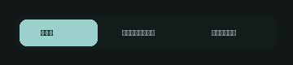
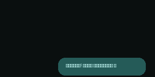
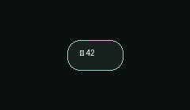

# Telegram Caelestia

Telegram Caelestia is an experimental visual customization of Telegram Desktop 7.3.3, distributed as a source patch and an Arch Linux `PKGBUILD`, with a separate browser-based motion concept lab. The desktop changes currently present in the source include a stretched animated tab indicator, rounded menu selection styling, and a more proportional panel entrance animation. The build recipe packages Telegram Desktop; the motion lab is a separate prototype and is not installed by that recipe.

> **Experimental:** The package replaces `telegram-desktop`. The current patch displays a performance HUD and writes diagnostic data to `/tmp/telegram_anim_perf.log`; see [profiling notes](docs/PROFILING.md). A clean package build has not yet been validated.

## Motion previews

These GIFs illustrate Motion Lab concepts; they are not recordings of the desktop client.

| Liquid tabs | Bubble launch | Reaction burst |
| :---: | :---: | :---: |
|  |  |  |

## What's here

| Path | Purpose |
| --- | --- |
| `PKGBUILD` | Arch Linux package recipe for Telegram Desktop 7.3.3 (`pkgrel=2`). |
| `patches/caelestia.patch` | Changes against the Telegram Desktop 7.3.3 full release. |
| `patches/night-green.tdesktop-theme` | Modified built-in theme used by the package build. |
| `motion_studio/` | Standalone HTML/CSS/JavaScript interaction prototype and sample GIFs. |
| `night-green-original.tdesktop-theme` | Original theme archive for manual import. |
| `docs/` | Additional documentation. |

Upstream sources and build artifacts are downloaded or generated locally and excluded from Git.

## Preview the motion lab

Open `motion_studio/index.html` in a modern browser. It is a self-contained page and does not require Node.js, a package manager, or a server. The cards demonstrate 24 interaction concepts across chat, navigation, media, and microinteraction categories. Use the category filters and speed controls to explore them; interactive demos run in the page. Approve/reject votes are saved in the browser's `localStorage` under `caelestia-motion-votes`, and the page can copy the current verdict summary.

The lab is a visual prototype, not an implementation of every concept in Telegram Desktop. Its integration file paths and timing labels are proposals shown on the cards and should be verified against the source before implementation. Three standalone reference animations are in `motion_studio/gifs/`.

## Build the desktop package

The recipe targets Arch Linux and uses `makepkg`. Review the package recipe and its dependency lists before building. From the project root, run:

```sh
makepkg -si
```

`makepkg` downloads and verifies the upstream Telegram Desktop 7.3.3 release, TDLib at commit `c15d3f5a5de6e3ba5839822c451152e5e18bb700`, wallet-engine 0.0.7, and the wallet-engine patch. The recipe builds wallet-engine, TDLib, and Telegram Desktop with CMake/Ninja, then installs the package through `makepkg`.

This is a native source build with a substantial C++ dependency toolchain; it is not a quick web build. The recipe's dependency and optional dependency lists are the authoritative package requirements. The recipe applies the Caelestia patch and replaces the built-in night-green theme during preparation.

## Import the theme

In Telegram Desktop, open **Settings → Chat Settings → Chat Background** (or the theme controls for your installed version) and import `night-green-original.tdesktop-theme`. The archive contains `colors.tdesktop-theme` and `background.png`. This theme is an optional separate asset; it is not automatically applied by `PKGBUILD`.

## Checks

Run `./scripts/check.sh` to check recipe syntax, local checksums, theme archives and referenced GIFs. Run `./scripts/check.sh --upstream` to also download and verify the upstream release and dry-run the patch. These checks do not compile the desktop client or test its UI.

See [changes](docs/CHANGES.md) for the patch inventory and [profiling](docs/PROFILING.md) for measurement limitations and a repeatable investigation plan.

## Local source changes

The current Caelestia-specific source annotations and edits can be found in:

- `tdesktop-7.3.3-full/Telegram/SourceFiles/ui/widgets/discrete_sliders.cpp` — elastic width adjustment while the tab indicator moves.
- `tdesktop-7.3.3-full/Telegram/lib_ui/ui/widgets/menu/menu_action.cpp` — rounded floating selection styling for menu items.
- `tdesktop-7.3.3-full/Telegram/lib_ui/ui/effects/panel_animation.cpp` — minimum proportional starting dimensions for panel entrance animation.

The complete changes are recorded in `patches/caelestia.patch`, generated against the 7.3.3 full release archive. No performance measurements are claimed.

## Upstream projects

- [Telegram Desktop](https://github.com/telegramdesktop/tdesktop)
- [TDLib](https://github.com/tdlib/td)
- [wallet-engine](https://github.com/i582/wallet-engine)

The package recipe's pinned versions, commit, checksums, and license fields define the exact inputs used for its package build.
